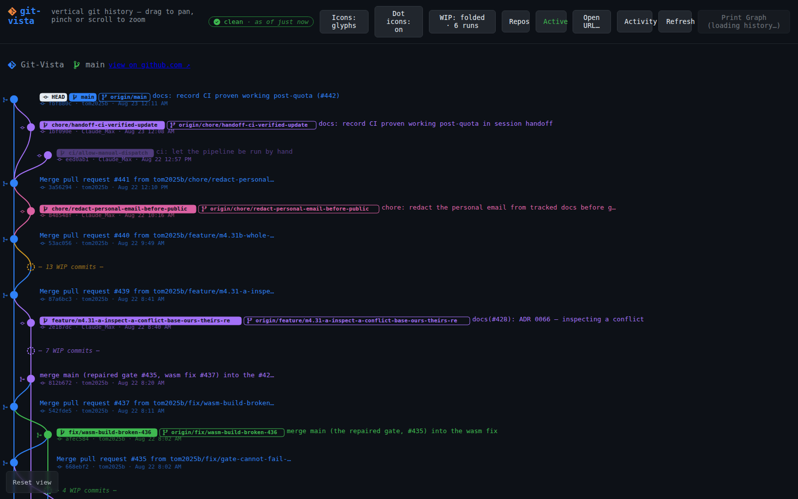
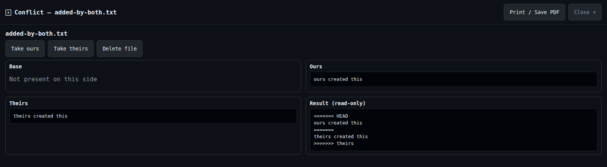

# Git-Vista

Git-Vista is a local-first visual Git client written in Rust. A Linux service
reads and mutates real repositories; a touch-first web interface, terminal UI,
and MCP bridge all use the same typed protocol and operation-planning model.

The project is built around one rule: a convenient Git interface must not make
the repository less truthful. Git remains authoritative. Reads report what Git
actually says, and every write is planned, checked against the repository
generation it was built from, serialized per repository, and recorded in the
operation journal before execution.

> **Development status:** Git-Vista is under active development at version
> `0.2.0`. The Linux service and browser client are the primary supported path.
> Windows containment is not implemented, so the server refuses to start there
> rather than silently running repository code without an equivalent sandbox.

## See it



The graph keeps children above parents, gives branches stable lanes, attaches
refs to the commits they name, folds WIP runs without rewriting history, and
virtualizes large histories.



Conflict inspection shows the base, ours, theirs, and working result as distinct
facts. Missing stages are named as missing instead of being rendered as empty
files.

More screenshots: [commit diff](docs/screenshots/02-diff.png),
[commit actions](docs/screenshots/03-commit-actions.png), and
[operation activity](docs/screenshots/04-activity.png).

## What is implemented

- Commit graph, commit details, refs, compare views, diffs, and file viewing.
- Porcelain-v2 working-tree status with staged and unstaged changes kept
  distinct.
- File, hunk, and changed-line staging; guarded discard and unstage operations.
- Commit, amend, branch, checkout, merge, rebase, cherry-pick, revert, stash,
  tag, fetch, pull, push, and upstream workflows through typed plans.
- Explicit force-with-lease planning; Git-Vista does not generate a bare
  `--force` push.
- Shared conflict inspection and resolution across operations that leave an
  unmerged index.
- Durable activity records, recovery refs, and contextual undo where an honest
  undo operation exists.
- A browser/PWA client, `gv-tui` terminal client, MCP bridge, and resumable
  exact-argv plan runner.
- Loopback sessions, CSRF and Host/Origin enforcement, policy-bounded Git
  execution, and a fail-closed Linux sandbox.

For capability details and known limits, start with the
[documentation index](docs/README.md). Architectural decisions in
[`docs/adr/`](docs/adr/) take precedence over older roadmap prose.

## Operating modes

| Mode | Listener | Writes | Intended use |
| --- | --- | --- | --- |
| Local | `127.0.0.1` | Yes | Browser on the Linux host |
| SSH tunnel | `127.0.0.1` through a local forward | Yes | iPad or another trusted client |
| LAN view | Explicit LAN address | **No** | Read-only backup view on a trusted home LAN |

The write-capable service never binds directly to Wi-Fi, a VPN interface, or a
public address. `--lan-view` starts a separate read-only profile; it is not a
shortcut around the loopback boundary. See
[Remote Linux Architecture](docs/REMOTE_ARCHITECTURE.md) and
[Security Model](docs/SECURITY_MODEL.md).

## Requirements

The enforced and measured floors are documented in
[Supported Versions](docs/SUPPORTED_VERSIONS.md):

- Linux kernel **6.12 or later**, providing Landlock ABI 6.
- `bubblewrap` (`bwrap`) for the Strict sandbox tier.
- Git **2.32 or later**. A few preview/revert features require Git 2.38 and
  degrade explicitly on older supported Git versions.
- Stable Rust with `rustfmt`, Clippy, and the `wasm32-unknown-unknown` target.
- [Trunk](https://trunkrs.dev/) to build the browser client.
- A native C toolchain for dependencies that include C or assembly.

On Ubuntu 24.04, the stock 6.8 kernel is below the hard sandbox floor. Install
an HWE kernel that supplies Landlock ABI 6 or later before expecting the server
to start. Git-Vista checks the actual host capability at startup and refuses to
downgrade.

Typical development setup:

```sh
rustup component add rustfmt clippy
rustup target add wasm32-unknown-unknown
cargo install trunk
sudo apt install bubblewrap build-essential
```

## Quick start

Clone the repository on the Linux host, then launch Git-Vista against a Git
working tree:

```sh
git clone https://github.com/tom2025b/git-vista.git
cd git-vista
./gv /absolute/path/to/repository
```

`gv` builds the browser bundle and server, starts the loopback service, and
prints a one-time sign-in URL:

```text
gv: sign in on the iPad/browser by opening this one-time link:
gv:   http://localhost:8080/#s=<token>
```

Open the complete URL on the same machine. The fragment is exchanged for an
HttpOnly session cookie and is single-use; it is not sent in an HTTP request or
written to server logs. Run `./gv --token` for a new browser or device.

Useful launcher commands:

```sh
./gv .                       # current repository
./gv ~/projects/example     # repository by path
./gv doctor                  # listener, session, tunnel, and capability checks
./gv --token                 # issue a fresh one-time sign-in URL
./gv --stop                  # stop the server owned by this checkout
./gv --port 8081 .           # select another instance port
./gv --root ~/projects       # add repos directly under a catalog root
./gv --lan-view .            # separate read-only trusted-LAN listener
./gv --help                  # complete launcher reference
```

### iPad through an SSH tunnel

Keep the Git-Vista service loopback-only on Linux. From the client, forward a
local port to the service:

```sh
ssh -N -L 8080:127.0.0.1:8080 linux-user@linux-host
```

With the tunnel connected, run `./gv --token` on Linux and open the printed
`http://localhost:8080/#s=...` URL on the iPad. In that URL, `localhost` is the
iPad end of the SSH forward. Opening the Linux host's `127.0.0.1` address from
Safari without a tunnel cannot work: on the iPad that address means the iPad.

## Safety model

Git-Vista separates planning from execution:

```text
browser / TUI / MCP client
          |
          v
versioned protocol -> typed operation -> reviewable plan
                                           |
                                           v
                         generation and precondition checks
                                           |
                                           v
                         per-repository serialized executor
                                           |
                                           v
                         sandboxed exact-argv Git process
                                           |
                                           v
                              durable operation journal
```

Important consequences:

- Browser and MCP callers cannot send arbitrary shell commands.
- Plans name the exact operation, targets, risk, and preconditions.
- A plan built from stale repository state is rejected rather than applied to a
  different state.
- Repository mutations are serialized, so two accepted writes do not race.
- Local Git operations use the Strict sandbox tier. If the required Linux
  containment cannot be constructed, the operation does not run.
- Network operations use a separately constrained tier and server-authored
  transport policy.
- Unsandboxed execution is reserved for repositories the operator explicitly
  trusts; it is never an automatic fallback.

The full boundary and its residual risks are documented in
[Security Model](docs/SECURITY_MODEL.md). For a plain-language explanation,
read [The Git-Vista Sandbox, Explained](docs/SANDBOX_EXPLAINED.md).

## Architecture

```text
                         same-origin HTTP API
 browser / PWA  ------------------------------------+
 gv-tui          -----------------------------------+--> git-vista-server
 git-vista-mcp   -----------------------------------+       |
                                                          +-- gix reads
                                                          +-- typed planner
                                                          +-- journal
                                                          +-- sandboxed Git writes
```

The workspace keeps platform and trust boundaries explicit:

| Crate | Responsibility |
| --- | --- |
| `git-vista-core` | Wasm-safe domain types, status parsing, graph layout, and pure logic |
| `git-vista-protocol` | Versioned wire DTOs and plan export types |
| `git-vista-conflicts` | Shared conflict view and resolution model |
| `git-vista-git` | Native repository reads through `gix` |
| `git-vista-server` | Axum API, planner, executor, journal, and sandbox policy |
| `git-vista-session` | Session bootstrap client shared by non-browser clients |
| `git-vista` | Leptos/WebAssembly browser application |
| `gv-tui` | Terminal user interface |
| `git-vista-mcp` | MCP stdio bridge to the same HTTP boundary |
| `git-vista-plan-runner` | Exact-argv YAML manifests and resumable `gv-run` |
| `gv-scrollcast` | Offline graph-to-video renderer |
| `git-vista-fixtures` | Deliberately shaped test repositories; development only |

Read [Remote Linux Architecture](docs/REMOTE_ARCHITECTURE.md) for the service
shape and [`docs/adr/`](docs/adr/) for individual decisions.

## Development

The repository's `dev` script is the supported entry point for repeatable
developer workflows:

```sh
./dev gate       # formatting, Clippy, tests, Wasm build, and browser suite
./dev verify     # sandbox escape report, censuses, mutants, daemon leak check
./dev browser    # browser render-path tests
./dev serve .    # start through the normal launcher
./dev testbed <ref> [port]  # isolated human-driven application test
./dev help       # all project commands
```

For a quicker pre-push pass, the principal checks are:

```sh
cargo fmt --all -- --check
cargo clippy --workspace --all-targets -- -D warnings
cargo clippy -p git-vista --target wasm32-unknown-unknown --all-targets -- -D warnings
cargo test --workspace
(cd crates/git-vista && trunk build)
```

GitHub Actions additionally runs contract gates, the sandbox escape battery,
`cargo audit`, secret scanning, and the browser suite. See
[Release Gates](docs/RELEASE_GATES.md) for the acceptance model.

## Invariant receipts

[`invariants.yaml`](invariants.yaml) is the first self-audit suite for
[Invariant Receipt](https://github.com/tom2025b/invariant-receipt). It declares
specific realistic breaks in status parsing, push safety, tracked-file discard,
graph layout, and staging coordinates, then names the existing test that must
catch each break.

Invariant Receipt never invents mutations and does not treat a compile error,
wrong test, timeout, or unrelated failure as evidence. See
[Invariant Receipts for Git-Vista](docs/INVARIANT_RECEIPTS.md) for the contract,
the current five invariants, and the Linux workflow.

## Documentation

Use [the documentation index](docs/README.md) to find operator instructions,
security boundaries, supported-version evidence, architecture, release policy,
and historical records.

Documentation has different authority levels:

1. Current code, tests, and enforced CI contracts.
2. Accepted ADRs in [`docs/adr/`](docs/adr/).
3. Current operator/reference documents linked from [`docs/README.md`](docs/README.md).
4. Roadmaps, investigations, handoffs, and work notes, which may describe a
   point in time or a proposal.

When two documents disagree, prefer the higher-authority source and fix the
stale document rather than averaging the claims.

## License

Git-Vista is licensed under the [MIT License](LICENSE).
